# Level Up at SRM: a redesign of srmist.edu.in

A concept redesign of the website of **SRM Institute of Science and Technology** (Kattankulathur, Chennai), built with
Next.js, React Three Fiber and GSAP. It turns a university site into something you play: a student's years at SRM
become a character who levels up, the campus becomes a 3D world you can walk, and every fact on the page comes from
SRM's own published data.

**[Live site →](https://srm-redesign-one.vercel.app)** · **[Play Walk SRM →](https://srm-redesign-one.vercel.app/walk)**

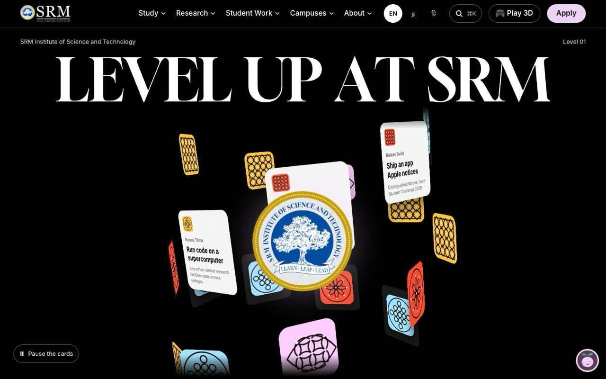

> An independent project made by Shreyas, Tulsi and Arnadeep; not the official SRM website. Fees, dates and
> rankings come from SRM's published pages; always confirm admissions details with SRM.

---

## Contents

- [What's different from srmist.edu.in](#whats-different-from-srmisteduin)
- [What's inside](#whats-inside)
- [Walk SRM: the campus as a 3D game](#walk-srm-the-campus-as-a-3d-game)
- [Quality: performance and accessibility](#quality-performance-and-accessibility)
- [Tech stack](#tech-stack)
- [Run it locally](#run-it-locally)
- [Project structure](#project-structure)
- [How the content stays accurate](#how-the-content-stays-accurate)
- [Credits](#credits)

## What's different from srmist.edu.in

Measured side by side on 5 November 2026: the public homepage of www.srmist.edu.in and this project's production
build, with Lighthouse 13.5 (mobile, simulated slow 4G, a fresh visit) and axe-core. Full results in
[docs/AUDIT.md](docs/AUDIT.md).

| | srmist.edu.in (homepage) | This redesign (homepage) |
|---|---|---|
| Lighthouse: performance | 49 | **94** |
| Lighthouse: accessibility | 81 | **100** |
| Lighthouse: best practices | 77 | **100** |
| Lighthouse: SEO | 85 | **100** |
| Page weight | 10.1 MB | **1.1 MB** |
| Requests | 386 | **101** |
| First paint (slow 4G) | 21.8 s | **1.2 s** |
| Scripts | 62 (39 block rendering; jQuery included 45 times) | One bundle per page; 3D, motion and chat load only when needed |
| Text that fails contrast | 15 elements | **0** (axe-core) |
| Links with no accessible name | 35 | **0** |
| Touch targets too small | 37 | **44 px minimum everywhere** |
| Security headers | Referrer-Policy only | Content-Security-Policy, X-Frame-Options, X-Content-Type-Options, Permissions-Policy, COOP |

And what it adds, on top of the same information:

- **Search in plain words** across every programme, with an AI that can only pick SRM's real programmes
- **Ask SRM**, an assistant answering from SRM's published data, in English, Tamil and Hindi
- **The full cost of a course** (tuition, hostel, mess) on every programme page, and **Parent Mode** for plain answers
- **Compare** up to three programmes side by side
- **A 3D hostel finder** and **Walk SRM**, the real campus as a game
- **Lite Mode** and **offline** support for slow connections

Scores are a snapshot of one day; the existing site may have changed since.

## What's inside

### A homepage you scroll through like a story

On a first visit, scrolling plays a glide through SRM's real arch gate (an image sequence from SRM's campus film),
which opens into the homepage. The page is organised around SRM's tagline, **Learn. Leap. Lead.**: find a programme,
see real student work, then rankings, placements and research, each leading to its part of the site.

| Scroll-driven gate intro | Find your campus |
|---|---|
| 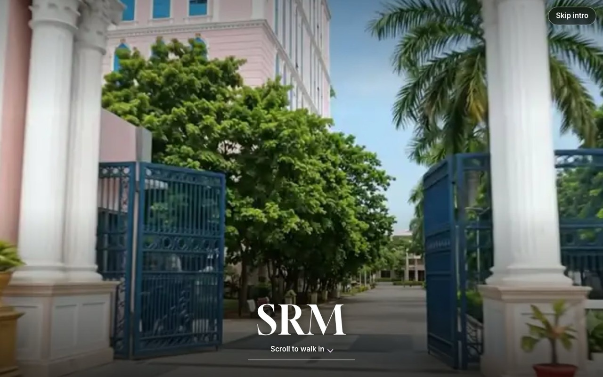 | 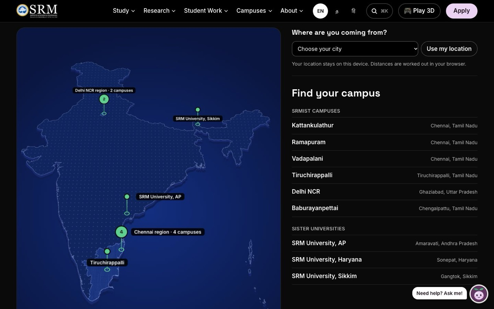 |

### Finding the right programme

- **Programme finder** with instant search over 29 programmes, level and college filters, and fees on every card.
- **AI search**: type what you mean ("help sick people", "something with sketching and circuits"). An LLM picks only
  from SRM's real programme list, and fees always come from the data, never from the model.
- **Programme pages** with an at-a-glance strip, careers, placements, a **"What will it cost?"** calculator (tuition,
  hostel and mess for the whole course, from SRM's published fee tables) and **Parent Mode**, which rewrites the page
  into plain answers about cost, safety, hostel and jobs.
- **Compare** up to three programmes side by side, with a shareable link.

| Programme finder | A programme page |
|---|---|
| 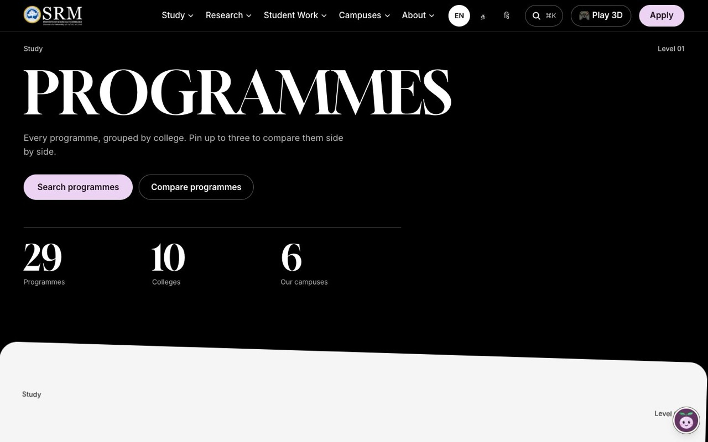 | 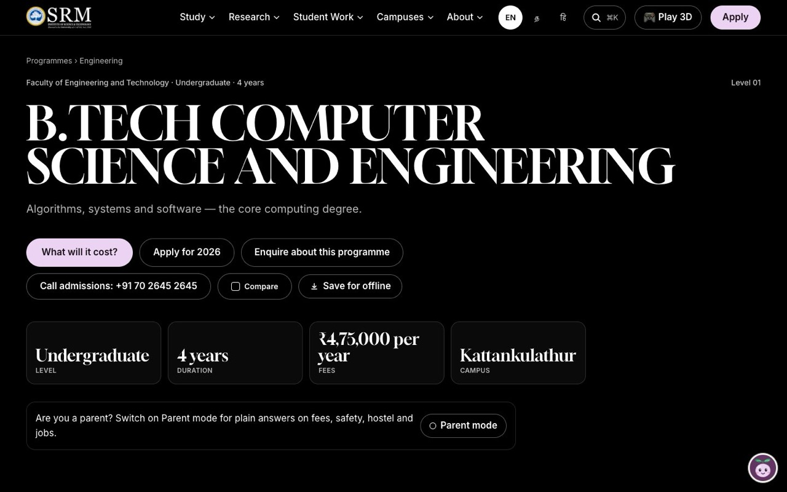 |

### Ask SRM, an assistant grounded in real data

Leafy, the site's mascot, opens a chat on every page. Questions about fees, deadlines, hostels, rankings and campuses
are answered from SRM's data with source links and admissions phone numbers, in English, Tamil and Hindi. An optional
LLM handles anything the rules can't, and the panel says when AI helped.

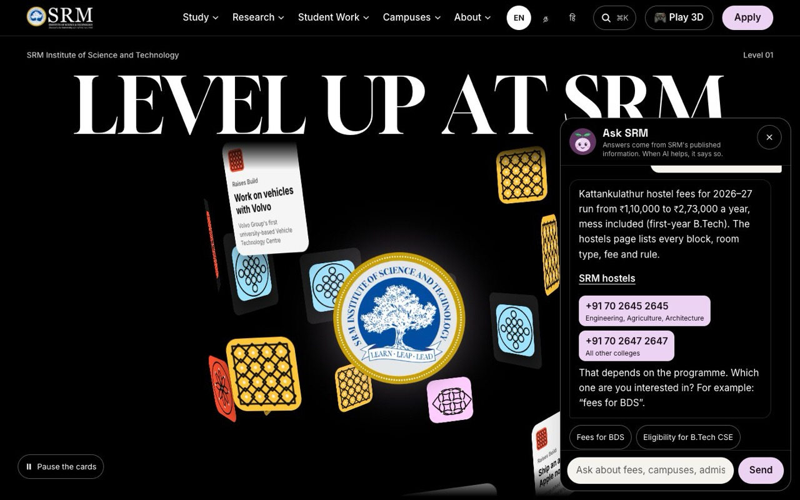

### Hostels in 3D

A 3D model of the Kattankulathur campus built from OpenStreetMap. Tap a hostel and the camera flies to it and opens
its card: entrance photo, room types, this year's lowest fee and who to call. A plain list does the same job without
3D.

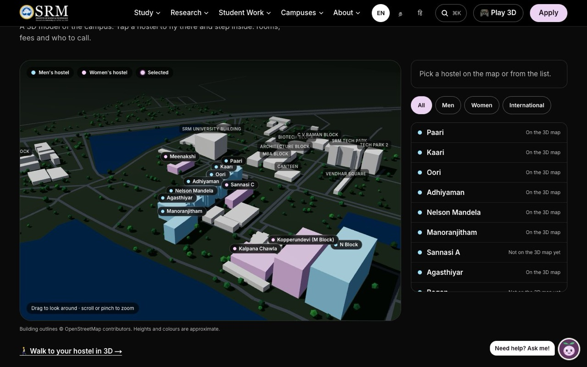

### Built for every visitor

| English, தமிழ், हिन्दी | On a phone |
|---|---|
| 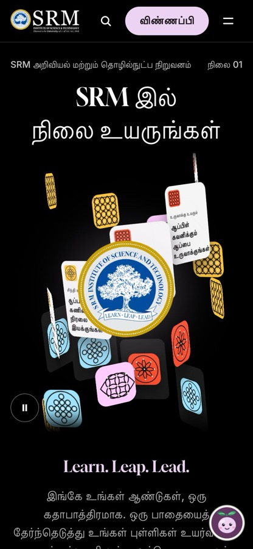 | 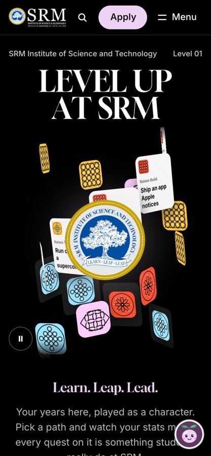 |

- **Three languages** throughout, including programme names, fees and the assistant.
- **Lite Mode** switches on automatically on Save-Data, slow connections or reduced motion: no video, 3D or smooth
  scrolling, and all of the information.
- **Works offline**: a hand-written service worker keeps key pages and saved programmes available with no signal.
- **Command palette** (⌘K / Ctrl+K) for every programme, page and action.
- **Link previews**: shared programme and campus links show a branded card with the real fee and NIRF rank.
- **Built-in A/B testing** (`lib/ab.ts`): variants are chosen before first paint, so pages stay static and never
  flicker. No cookies and no personal data. Results are at `/lab`.

## Walk SRM: the campus as a 3D game

`/walk` turns the real Kattankulathur campus into a small open world in an anime ink style. Open it from **🎮 Play 3D**
in the header, the homepage hero, or the campus and hostel pages.

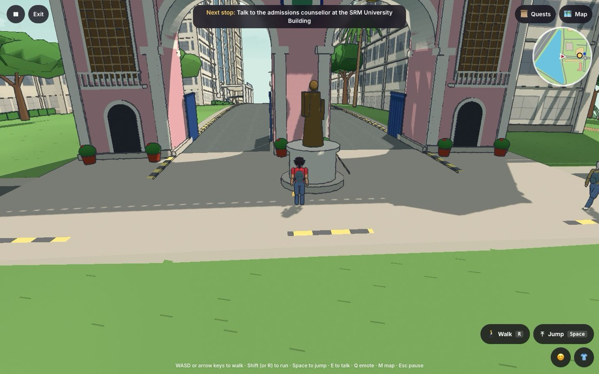

- **A real campus.** Roads, footpaths, lakes and building outlines come from OpenStreetMap, drawn at 0.65 scale so
  walks stay short (building heights are real). Hostel floor counts come from SRM's hostel data.
- **Real landmarks**: the pink **arch gate** at the entrance and the **clock tower** on its roundabout (modelled on
  footage, with clocks showing the live time in Chennai to the second and a bell that strikes the hour), and **TP Ganesan Auditorium** with its ramps and the two mini
  halls under them (from SRM's own description; the look is approximate). Past the main road runs the **railway**
  (three electrified tracks from OpenStreetMap) with **Potheri station**: a platform, canopy and name boards, and a
  suburban train that pulls in, waits and leaves every hundred seconds, with a horn when you're nearby.
- **Buildings with character**: the University Building, Tech Park, the orange Tech Park 2, hostels with balconies,
  SRM Global Hospitals and over forty named places, each opening its page on the site.
- **People to meet.** Seventeen characters at real buildings answer questions from the site's own data and give
  fourteen quests: running errands for the Camber Racing team, club activities (a club fair, an Astrophilia star party,
  a Music Club jam, a Gaming Club LAN night, a Rotaract clean-up drive, a Creative Arts sketch walk, Dance Club
  practice), a Quiz Club quiz with questions from SRM's own facts, and timed runs against the clock. Finished club
  quests stay visible on campus: the dancer keeps dancing (and you dance too), the painting stands on its easel, the
  guitar plays, the telescope, the gaming desk, the trophy, the stalls and the new bins are all there. Students walk the
  roads too; they wave, answer your emotes and tell you where they're heading.
- **Play with friends.** Start a room from 👥 Friends and share the link: everyone who opens it walks the same campus
  with you, in their own outfit and with a name tag. Chat (T), emote, talk by voice (louder the closer you stand), jump
  to a friend from the map, and do quests together: a step one of you does counts for everyone at that step. Browsers
  connect straight to each other over WebRTC ([Trystero](https://github.com/dmotz/trystero)); a few public Nostr relays
  only introduce them, so there's no account and no game server.
- **Play your way**: walk, run or jump with the keyboard, tap the ground to walk there, or use a thumb stick on a
  phone. Dress your own student, choose your walking speed, and jump anywhere from the map.
- **Light on the network.** The game loads only after you press Begin, the characters are built in code (no model
  downloads), and Lite Mode or a device without WebGL gets a full text tour instead.

| The clock tower on its roundabout | The campus from above |
|---|---|
| 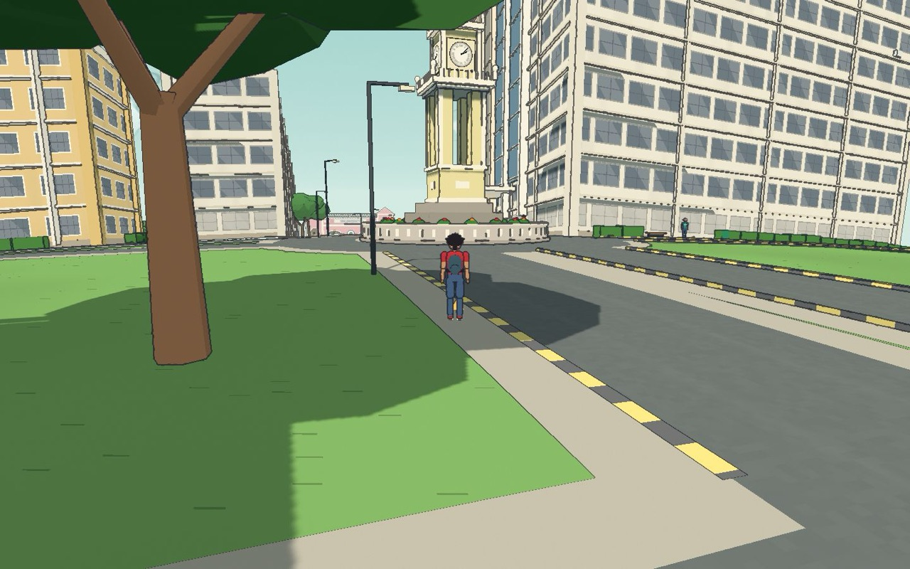 | 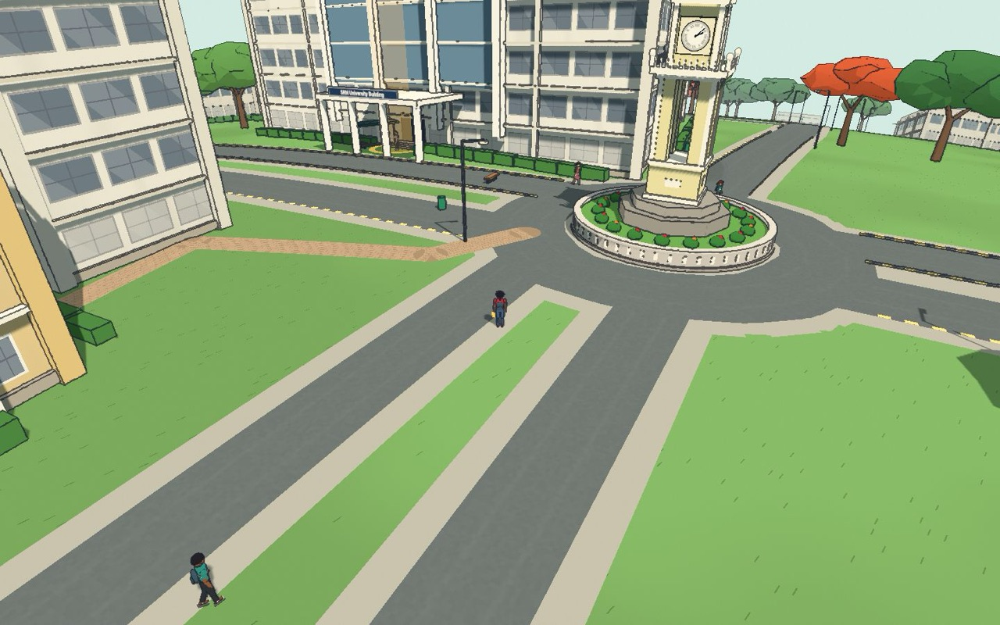 |

| Hostels | SRM Global Hospitals |
|---|---|
| 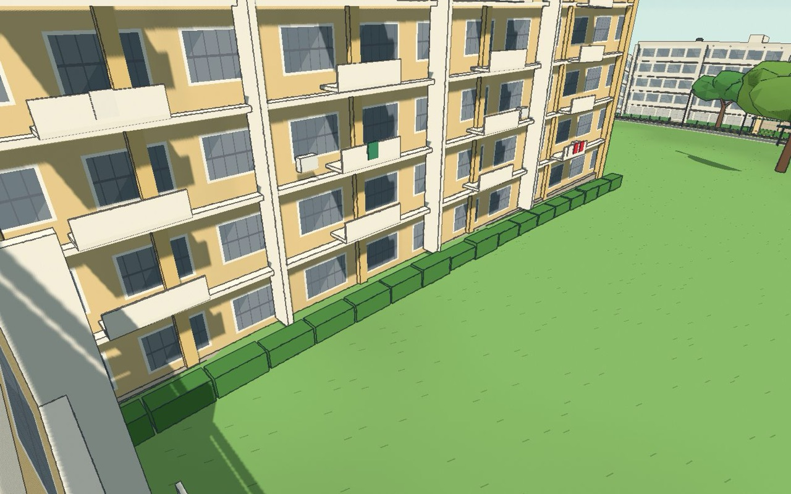 | 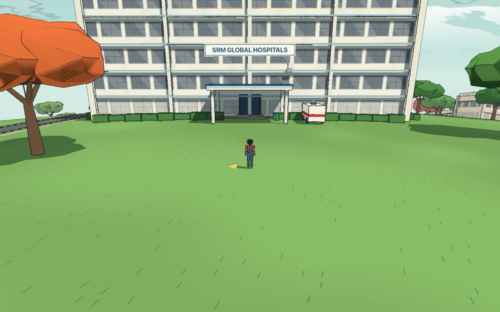 |

## Quality: performance and accessibility

Lighthouse, mobile, simulated slow 4G, production build (5 November 2026):

| Page | Performance | Accessibility | Best Practices | SEO |
|---|---|---|---|---|
| Homepage | 94 | 100 | 100 | 100 |
| Programmes | 95 | 100 | 100 | 100 |
| A programme page | 95 | 100 | 100 | 100 |
| Hostels (3D) | 94 | 100 | 100 | 100 |
| Tamil homepage | 94 | 100 | 100 | 100 |

The existing srmist.edu.in homepage scored 49 / 81 / 77 / 85 in the same test. Full results are in
[docs/AUDIT.md](docs/AUDIT.md).

- **Accessibility:** every page type passes axe-core (WCAG 2.2 AA), with a skip link, visible focus rings, 44 px tap
  targets and no sideways scrolling from 360 px up. With reduced motion, nothing animates or pins.
- **JavaScript:** about 139 kB on the homepage's first load. 3D, motion libraries, the chat panel and the intro frames
  load only when needed.
- **Security:** Content-Security-Policy and related headers, escaped JSON-LD, rate-limited API routes, and no secrets
  in the repository.

## Tech stack

| | |
|---|---|
| Framework | Next.js 15 (App Router), React 19, TypeScript (strict) |
| Styling | Tailwind CSS v4 with design tokens as CSS variables |
| Motion | GSAP + ScrollTrigger, Lenis smooth scroll (both loaded after the page, off in Lite Mode) |
| 3D | three.js, React Three Fiber and drei, with custom shaders for the curved world, toon lighting and ink outlines |
| Languages | next-intl (English, Tamil, Hindi) |
| Search and AI | Fuse.js on the client; any OpenAI-compatible LLM endpoint (optional), called with plain `fetch` |
| Images and fonts | next/image (AVIF/WebP) and next/font, self-hosted |
| Hosting | Vercel |

## Run it locally

Requires Node.js 20 or newer.

```sh
git clone https://github.com/shreyascode11/SRM-Redesign.git
cd SRM-Redesign
npm install
npm run dev        # http://localhost:3000
```

No API keys are needed: the site, search, programme matcher and rule-based assistant all work without them. Optional
settings go in `.env.local` (see `.env.example`):

| Variable | What it does |
|---|---|
| `NEXT_PUBLIC_SITE_URL` | The site's public address, for the sitemap, SEO tags and link previews |
| `LLM_BASE_URL`, `LLM_API_KEY`, `LLM_MODEL` | Turn on AI search and the assistant's AI answers with any OpenAI-compatible endpoint (for example Groq) |
| `ENQUIRY_WEBHOOK_URL` | Where the admission enquiry form sends submissions |

| Command | What it does |
|---|---|
| `npm run build` | Production build (runs the content checks first) |
| `npm run lint` · `npm run typecheck` | ESLint (zero warnings allowed) and the TypeScript compiler |
| `npm run check:content` | Validates every content file: references, stats and translation coverage |
| `npm run i18n:review` | Exports every Tamil and Hindi string to a CSV for a native-speaker review |
| `node scripts/build-campus-walk.mjs <osm.json> <names.json>` | Rebuilds the Walk SRM world from an OpenStreetMap export |

## Project structure

```
app/[locale]/       pages: home, programmes, programme detail, compare, campuses, hostels, stories, research, walk, …
app/api/            programme matcher, AI search, the Ask SRM assistant, enquiry form, search index, A/B results
components/         homepage, navigation, programme pages, assistant, 3D hostel finder, map, walk (the game)
content/            programmes, colleges, campuses, hostels, stories, research and the game's places and people (JSON)
content/i18n/       Tamil and Hindi translations of the content
messages/           interface text in English, Tamil and Hindi
lib/                content loading, search, recommender, LLM client, assistant rules, A/B testing, map maths
public/             photos, the intro frames, map data and the Walk SRM world
scripts/            content checks, map and world builders, link checker, UI audit, A/B end-to-end test
docs/               audit results, design reference, README images
```

## How the content stays accurate

- **Every fact has a source.** Fees, eligibility, entrance exams and dates come from SRM's 2026 admission pages and
  its 2026–27 brochure, and each programme lists its sources.
- **Unknown stays unknown.** Anything SRM hasn't published is marked `TODO` in the data and hidden on the live site,
  never guessed.
- **AI never invents facts.** The AI picks and explains; fees, dates and eligibility shown to the visitor always come
  from the data files.
- **Real photos.** SRM's own photos plus openly licensed images from Wikimedia Commons, each credited. Every file's
  origin is listed in [content/media-credits.json](content/media-credits.json).

## Credits

**Made by Shreyas, Tulsi and Arnadeep.**

The SRM name, logo, emblem and photographs belong to SRM Institute of Science and Technology and are used only in this
concept redesign. Map data © OpenStreetMap contributors (ODbL). The homepage's structure and motion take their cue from
[Grail](https://grail-app.com) and Walk SRM from Abeto's [Messenger](https://messenger.abeto.co); no copy, art, models or
code were taken from either. Fonts, data sources and other third-party assets are listed in [CREDITS.md](CREDITS.md).
